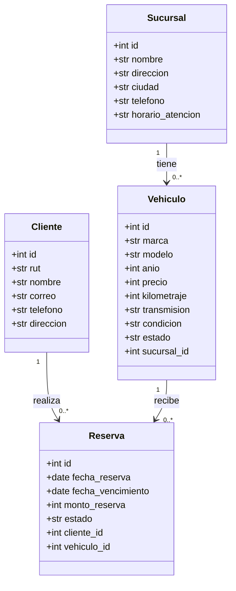
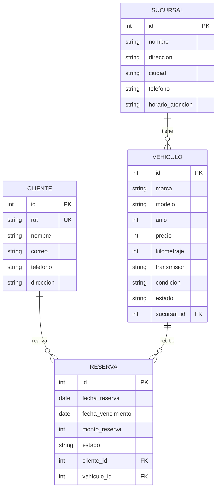

# Diagramas del sistema

## 1. Diagrama de clases del dominio

El siguiente diagrama representa las entidades principales del sistema de concesionaria, sus atributos y las relaciones entre ellas.

## 2. Diagrama de datos

El siguiente diagrama representa la estructura de las tablas persistidas mediante SQLAlchemy ORM, incluyendo sus claves primarias, claves foráneas y restricciones de unicidad.

## 3. Relaciones entre entidades

### Sucursal y vehículo

Una sucursal puede tener asociados varios vehículos.

Cada vehículo pertenece a una sucursal mediante el atributo `sucursal_id`, que actúa como clave foránea.

Cardinalidad:

- Una sucursal puede tener cero o muchos vehículos.
- Cada vehículo pertenece a una sucursal.

### Cliente y reserva

Un cliente puede realizar distintas reservas a lo largo del tiempo.

Cada reserva referencia a un cliente mediante `cliente_id`.

Cardinalidad:

- Un cliente puede tener cero o muchas reservas.
- Cada reserva pertenece a un cliente.

### Vehículo y reserva

Un vehículo puede aparecer en diferentes registros de reserva a lo largo del historial del sistema.

Cada reserva referencia a un vehículo mediante `vehiculo_id`.

Cardinalidad:

- Un vehículo puede tener cero o muchas reservas históricas.
- Cada reserva referencia a un vehículo.

Las reglas del servicio de reservas controlan la disponibilidad y evitan reservas activas incompatibles para un mismo vehículo.

## 4. Dominio y persistencia

El diagrama de clases representa las entidades principales del dominio y sus relaciones conceptuales.

El diagrama de datos representa las tablas persistidas en la base de datos y permite identificar:

- **PK (Primary Key):** identificador principal de cada registro.
- **FK (Foreign Key):** referencia a otra tabla mediante una clave foránea.
- **UK (Unique Key):** restricción de unicidad aplicada al RUT del cliente.

Los modelos ORM implementan las relaciones entre sucursales, vehículos, clientes y reservas mediante SQLAlchemy.

La persistencia permite mantener la integridad referencial de los registros y representar las asociaciones entre las entidades del sistema.