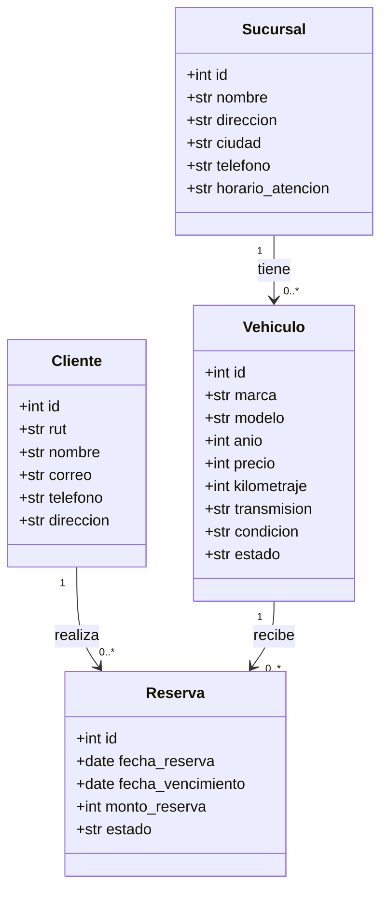
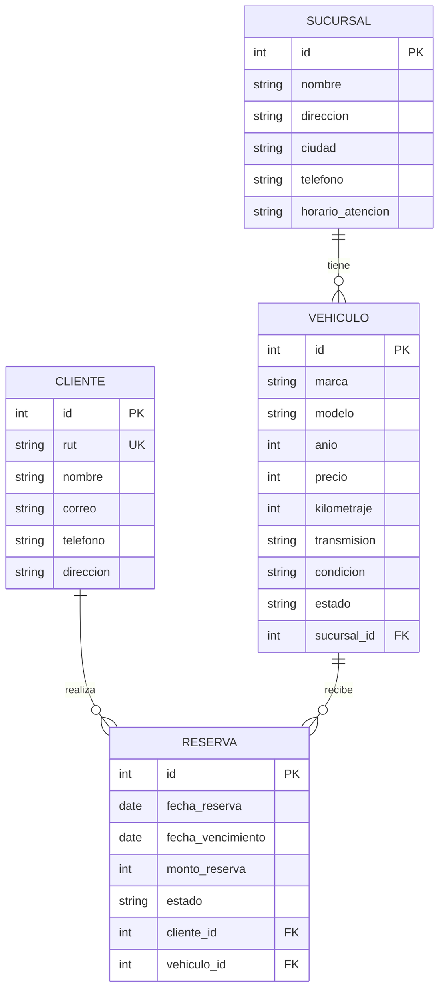

# Diagramas del sistema

## Diagrama de clases del dominio

## Diagrama de datos

## Dominio y persistencia

El diagrama de clases representa las entidades del dominio y sus relaciones. El diagrama de datos representa las tablas persistidas, sus claves primarias (PK), claves foráneas (FK) y la restricción de unicidad del RUT.